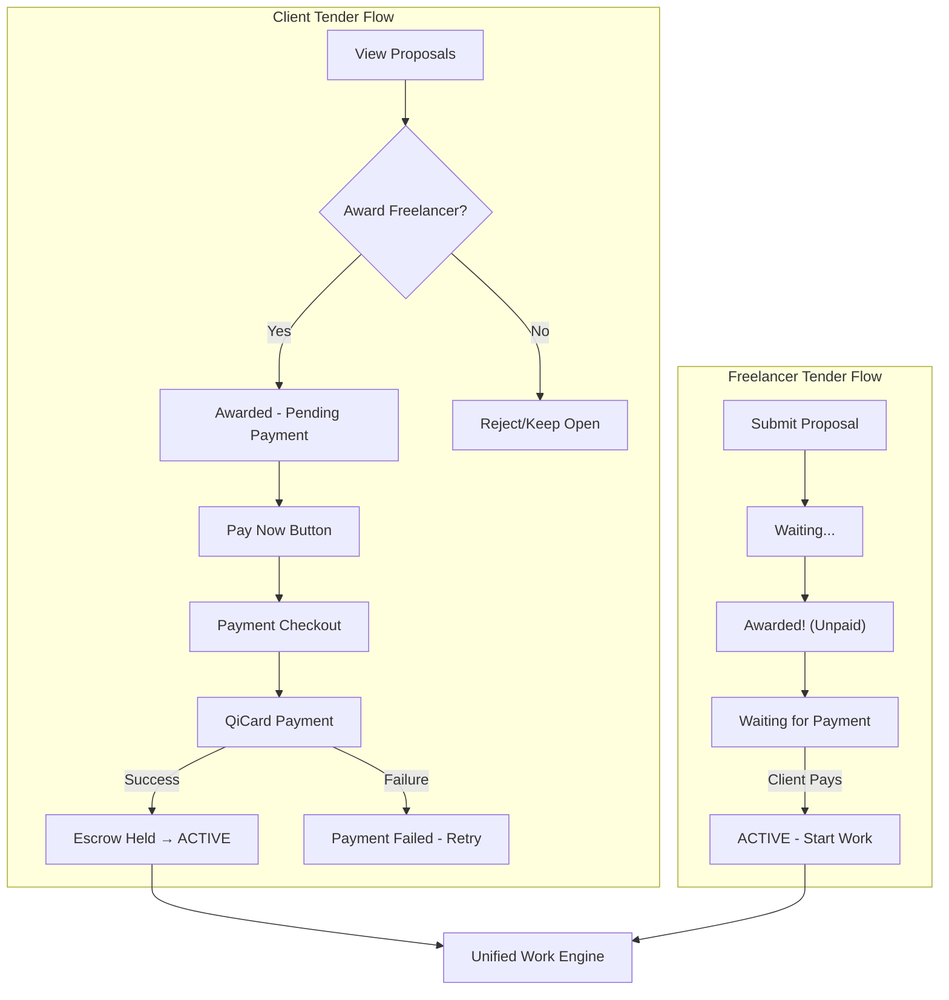

# Task/Tender Payment Flow Implementation Plan

## Overview

This plan implements the missing **Two-Step Award → Payment Flow** for Task Tenders to match the Client/Freelancer diagram specifications.

### Current vs Expected Flow

**Current (Broken):**
```
Client posts tender → Freelancer proposes → Client "accepts" (payment happens instantly)
```

**Expected (To Implement):**
```
Client posts tender → Collects proposals → AWARDS freelancer → 
PENDING PAYMENT (Awarded) → Client pays → Escrow held → ACTIVE
```

---

## Architecture



---

## Phase 1: Database Schema Updates

### 1.1 New Migration: `20260226_tender_award_payment_flow.sql`

```sql
-- ============================================================================
-- TENDER AWARD & PAYMENT FLOW
-- Implements two-step: Award → Payment for task tenders
-- ============================================================================

-- 1. Ensure task_requests table has proper payment_status tracking
-- (Already exists: payment_status enum with unpaid/held/released)

-- 2. Add award timestamp and expiration for "Pay Later" support
ALTER TABLE public.task_requests
ADD COLUMN IF NOT EXISTS awarded_at TIMESTAMPTZ,
ADD COLUMN IF NOT EXISTS payment_deadline TIMESTAMPTZ, -- When award expires
ADD COLUMN IF NOT EXISTS awarded_by UUID REFERENCES auth.users(id);

-- 3. Create index for finding awarded but unpaid offers
CREATE INDEX IF NOT EXISTS idx_task_requests_awarded_unpaid 
ON public.task_requests(status, payment_status) 
WHERE status = 'accepted' AND payment_status = 'unpaid';

-- 4. Create index for payment deadline cleanup
CREATE INDEX IF NOT EXISTS idx_task_requests_payment_deadline 
ON public.task_requests(payment_deadline) 
WHERE status = 'accepted' AND payment_status = 'unpaid';

-- ============================================================================
-- RPC: Award an Offer (Separate from Payment)
-- ============================================================================
CREATE OR REPLACE FUNCTION public.award_task_offer(
    p_request_id UUID,
    p_client_id UUID DEFAULT auth.uid()
)
RETURNS JSONB
LANGUAGE plpgsql
SECURITY DEFINER
AS $$
DECLARE
    v_request RECORD;
    v_task RECORD;
    v_now TIMESTAMPTZ := NOW();
    v_deadline TIMESTAMPTZ := v_now + INTERVAL '24 hours'; -- 24h to pay
BEGIN
    -- Validate request exists and is pending
    SELECT * INTO v_request
    FROM public.task_requests
    WHERE id = p_request_id
    AND status = 'pending';
    
    IF v_request IS NULL THEN
        RETURN jsonb_build_object(
            'success', false,
            'error', 'Request not found or not in pending status'
        );
    END IF;
    
    -- Verify client owns the task
    SELECT * INTO v_task
    FROM public.tasks
    WHERE id = v_request.task_id
    AND user_id = p_client_id;
    
    IF v_task IS NULL THEN
        RETURN jsonb_build_object(
            'success', false,
            'error', 'Only task owner can award offers'
        );
    END IF;
    
    -- Check if task already has an accepted offer
    IF EXISTS (
        SELECT 1 FROM public.task_requests 
        WHERE task_id = v_request.task_id 
        AND status = 'accepted'
        AND id != p_request_id
    ) THEN
        RETURN jsonb_build_object(
            'success', false,
            'error', 'Task already has an accepted offer'
        );
    END IF;
    
    -- Award the offer (but don't pay yet)
    UPDATE public.task_requests
    SET 
        status = 'accepted',
        payment_status = 'unpaid',  -- Explicitly unpaid
        awarded_at = v_now,
        payment_deadline = v_deadline,
        awarded_by = p_client_id,
        updated_at = v_now
    WHERE id = p_request_id;
    
    -- Update task status to indicate awarded but not paid
    UPDATE public.tasks
    SET 
        assigned_freelancer_id = v_request.freelancer_id,
        status = 'assigned',  -- New status: assigned but not active
        updated_at = v_now
    WHERE id = v_request.task_id;
    
    -- Reject all other pending offers on this task
    UPDATE public.task_requests
    SET 
        status = 'rejected',
        updated_at = v_now
    WHERE task_id = v_request.task_id
    AND status = 'pending'
    AND id != p_request_id;
    
    -- Create notification for freelancer
    INSERT INTO public.notifications (
        user_id,
        type,
        title,
        body,
        data,
        read,
        created_at
    ) VALUES (
        v_request.freelancer_id,
        'offer_awarded',
        'Your offer was awarded!',
        'Client has selected your proposal for "' || v_task.title || '". Waiting for payment.',
        jsonb_build_object(
            'task_id', v_request.task_id,
            'request_id', p_request_id,
            'task_title', v_task.title
        ),
        false,
        v_now
    );
    
    -- Create notification for client (reminder to pay)
    INSERT INTO public.notifications (
        user_id,
        type,
        title,
        body,
        data,
        read,
        created_at
    ) VALUES (
        p_client_id,
        'payment_required',
        'Complete payment to start work',
        'You awarded a freelancer for "' || v_task.title || '". Pay within 24 hours to activate.',
        jsonb_build_object(
            'task_id', v_request.task_id,
            'request_id', p_request_id,
            'task_title', v_task.title,
            'payment_deadline', v_deadline
        ),
        false,
        v_now
    );
    
    RETURN jsonb_build_object(
        'success', true,
        'request_id', p_request_id,
        'task_id', v_request.task_id,
        'freelancer_id', v_request.freelancer_id,
        'payment_deadline', v_deadline,
        'status', 'accepted',
        'payment_status', 'unpaid'
    );
END;
$$;

-- ============================================================================
-- RPC: Pay for Awarded Offer (Completes the payment flow)
-- ============================================================================
CREATE OR REPLACE FUNCTION public.pay_awarded_offer(
    p_request_id UUID,
    p_client_id UUID DEFAULT auth.uid()
)
RETURNS JSONB
LANGUAGE plpgsql
SECURITY DEFINER
AS $$
DECLARE
    v_request RECORD;
    v_task RECORD;
    v_now TIMESTAMPTZ := NOW();
BEGIN
    -- Validate request exists, is awarded, and unpaid
    SELECT * INTO v_request
    FROM public.task_requests
    WHERE id = p_request_id
    AND status = 'accepted'
    AND payment_status = 'unpaid';
    
    IF v_request IS NULL THEN
        RETURN jsonb_build_object(
            'success', false,
            'error', 'Request not found or not in awarded/unpaid status'
        );
    END IF;
    
    -- Check if payment deadline expired
    IF v_request.payment_deadline < v_now THEN
        -- Auto-cancel expired award
        UPDATE public.task_requests
        SET 
            status = 'rejected',
            payment_status = 'unpaid',
            updated_at = v_now
        WHERE id = p_request_id;
        
        UPDATE public.tasks
        SET 
            assigned_freelancer_id = NULL,
            status = 'open',
            updated_at = v_now
        WHERE id = v_request.task_id;
        
        RETURN jsonb_build_object(
            'success', false,
            'error', 'Payment deadline expired. Award has been cancelled.',
            'expired', true
        );
    END IF;
    
    -- Verify client owns the task
    SELECT * INTO v_task
    FROM public.tasks
    WHERE id = v_request.task_id
    AND user_id = p_client_id;
    
    IF v_task IS NULL THEN
        RETURN jsonb_build_object(
            'success', false,
            'error', 'Only task owner can pay for offers'
        );
    END IF;
    
    -- Update request to held status
    UPDATE public.task_requests
    SET 
        payment_status = 'held',
        updated_at = v_now
    WHERE id = p_request_id;
    
    -- Update task to active status (work starts now)
    UPDATE public.tasks
    SET 
        status = 'in_progress',
        updated_at = v_now
    WHERE id = v_request.task_id;
    
    -- Create notification for freelancer (work can start!)
    INSERT INTO public.notifications (
        user_id,
        type,
        title,
        body,
        data,
        read,
        created_at
    ) VALUES (
        v_request.freelancer_id,
        'work_active',
        'Payment confirmed - Start working!',
        'Client has paid for "' || v_task.title || '". Escrow held. Begin work now.',
        jsonb_build_object(
            'task_id', v_request.task_id,
            'request_id', p_request_id,
            'task_title', v_task.title
        ),
        false,
        v_now
    );
    
    RETURN jsonb_build_object(
        'success', true,
        'request_id', p_request_id,
        'task_id', v_request.task_id,
        'status', 'accepted',
        'payment_status', 'held'
    );
END;
$$;

-- ============================================================================
-- RPC: Get Client's Awarded Unpaid Offers (for "Pay Now" UI)
-- ============================================================================
CREATE OR REPLACE FUNCTION public.get_client_awarded_unpaid_offers(
    p_client_id UUID DEFAULT auth.uid()
)
RETURNS TABLE (
    request_id UUID,
    task_id UUID,
    freelancer_id UUID,
    price BIGINT,
    days INTEGER,
    note TEXT,
    awarded_at TIMESTAMPTZ,
    payment_deadline TIMESTAMPTZ,
    task_title TEXT,
    freelancer_name TEXT,
    freelancer_avatar TEXT
)
LANGUAGE sql
SECURITY DEFINER
STABLE
AS $$
    SELECT 
        tr.id as request_id,
        tr.task_id,
        tr.freelancer_id,
        tr.price,
        tr.days,
        tr.note,
        tr.awarded_at,
        tr.payment_deadline,
        t.title as task_title,
        p.full_name as freelancer_name,
        p.avatar_url as freelancer_avatar
    FROM public.task_requests tr
    JOIN public.tasks t ON t.id = tr.task_id
    JOIN public.profiles p ON p.id = tr.freelancer_id
    WHERE t.user_id = p_client_id
    AND tr.status = 'accepted'
    AND tr.payment_status = 'unpaid'
    AND tr.payment_deadline > NOW()
    ORDER BY tr.awarded_at DESC;
$$;

-- ============================================================================
-- RPC: Get Freelancer's Awarded Unpaid Offers (for "Waiting for Payment" UI)
-- ============================================================================
CREATE OR REPLACE FUNCTION public.get_freelancer_awarded_unpaid_offers(
    p_freelancer_id UUID DEFAULT auth.uid()
)
RETURNS TABLE (
    request_id UUID,
    task_id UUID,
    client_id UUID,
    price BIGINT,
    days INTEGER,
    note TEXT,
    awarded_at TIMESTAMPTZ,
    payment_deadline TIMESTAMPTZ,
    task_title TEXT,
    client_name TEXT,
    client_avatar TEXT
)
LANGUAGE sql
SECURITY DEFINER
STABLE
AS $$
    SELECT 
        tr.id as request_id,
        tr.task_id,
        t.user_id as client_id,
        tr.price,
        tr.days,
        tr.note,
        tr.awarded_at,
        tr.payment_deadline,
        t.title as task_title,
        p.full_name as client_name,
        p.avatar_url as client_avatar
    FROM public.task_requests tr
    JOIN public.tasks t ON t.id = tr.task_id
    JOIN public.profiles p ON p.id = t.user_id
    WHERE tr.freelancer_id = p_freelancer_id
    AND tr.status = 'accepted'
    AND tr.payment_status = 'unpaid'
    AND tr.payment_deadline > NOW()
    ORDER BY tr.awarded_at DESC;
$$;

-- ============================================================================
-- Cron Job: Clean up expired awards (runs every hour)
-- ============================================================================
CREATE OR REPLACE FUNCTION public.cleanup_expired_awards()
RETURNS void
LANGUAGE plpgsql
SECURITY DEFINER
AS $$
DECLARE
    v_now TIMESTAMPTZ := NOW();
    v_expired RECORD;
BEGIN
    FOR v_expired IN 
        SELECT tr.id, tr.task_id, tr.freelancer_id, t.title as task_title
        FROM public.task_requests tr
        JOIN public.tasks t ON t.id = tr.task_id
        WHERE tr.status = 'accepted'
        AND tr.payment_status = 'unpaid'
        AND tr.payment_deadline < v_now
    LOOP
        -- Revert offer to rejected
        UPDATE public.task_requests
        SET 
            status = 'rejected',
            updated_at = v_now
        WHERE id = v_expired.id;
        
        -- Revert task to open
        UPDATE public.tasks
        SET 
            assigned_freelancer_id = NULL,
            status = 'open',
            updated_at = v_now
        WHERE id = v_expired.task_id;
        
        -- Notify freelancer that award expired
        INSERT INTO public.notifications (
            user_id, type, title, body, data, read, created_at
        ) VALUES (
            v_expired.freelancer_id,
            'award_expired',
            'Award expired - Client did not pay',
            'The award for "' || v_expired.task_title || '" expired. Client did not complete payment in time.',
            jsonb_build_object('task_id', v_expired.task_id, 'request_id', v_expired.id),
            false,
            v_now
        );
    END LOOP;
END;
$$;

-- Add RLS policies for the new columns
ALTER TABLE public.task_requests ENABLE ROW LEVEL SECURITY;

-- Policy: Clients can view their awarded unpaid offers
CREATE POLICY "tr_view_client_awarded_unpaid" ON public.task_requests
FOR SELECT
TO authenticated
USING (
    EXISTS (
        SELECT 1 FROM public.tasks t
        WHERE t.id = task_requests.task_id
        AND t.user_id = auth.uid()
    )
    AND status = 'accepted'
    AND payment_status = 'unpaid'
);

-- Policy: Freelancers can view their awarded unpaid offers
CREATE POLICY "tr_view_freelancer_awarded_unpaid" ON public.task_requests
FOR SELECT
TO authenticated
USING (
    freelancer_id = auth.uid()
    AND status = 'accepted'
    AND payment_status = 'unpaid'
);

COMMENT ON TABLE public.task_requests IS 
'Task proposals/offers with two-step award→payment flow. Status: pending→accepted→(unpaid→held→released). Payment deadline enforced.';
```

---

## Phase 2: Service Layer Updates

### 2.1 Update `lib/features/tasks/services/task_service.dart`

Add new methods:

```dart
/// Award an offer (Step 1: Award without payment)
/// 
/// This creates an "Awarded but Pending Payment" state.
/// Client must call [payAwardedOffer] to complete payment and activate work.
Future<Map<String, dynamic>> awardOffer(String offerId) async {
  try {
    final result = await _client.rpc(
      'award_task_offer',
      params: {'p_request_id': offerId},
    );
    
    AppLogger.i('Offer awarded (pending payment): $offerId');
    return result as Map<String, dynamic>;
  } on PostgrestException catch (e, st) {
    AppLogger.e('Failed to award offer', error: e, stackTrace: st);
    throw Exception(ErrorMapper.map(e));
  }
}

/// Pay for an awarded offer (Step 2: Complete payment)
/// 
/// This triggers escrow hold and activates the work.
/// After success, freelancer can start working.
Future<Map<String, dynamic>> payAwardedOffer(String offerId) async {
  try {
    // 1. Mark the offer as paid in the database
    final result = await _client.rpc(
      'pay_awarded_offer',
      params: {'p_request_id': offerId},
    ) as Map<String, dynamic>;
    
    if (result['success'] != true) {
      throw Exception(result['error'] ?? 'Payment failed');
    }
    
    // 2. Create ledger entry for escrow hold
    final offerData = await _client
        .from('task_requests')
        .select('price')
        .eq('id', offerId)
        .single();
    final price = offerData['price'] as num? ?? 0;
    
    await LedgerService(_client).submitPaymentEvent(
      eventType: 'escrow_hold',
      relatedEntityType: 'task_request',
      relatedEntityId: offerId,
      amountGross: price,
      meta: {'awarded_at': DateTime.now().toIso8601String()},
    );
    
    AppLogger.i('Payment completed for awarded offer: $offerId');
    return result;
  } on PostgrestException catch (e, st) {
    AppLogger.e('Failed to pay for awarded offer', error: e, stackTrace: st);
    throw Exception(ErrorMapper.map(e));
  }
}

/// Get client's awarded but unpaid offers (for "Pay Now" UI)
Future<List<Map<String, dynamic>>> getClientAwardedUnpaidOffers() async {
  try {
    final result = await _client.rpc('get_client_awarded_unpaid_offers');
    return (result as List).cast<Map<String, dynamic>>();
  } catch (e, st) {
    AppLogger.e('Failed to get awarded unpaid offers', error: e, stackTrace: st);
    return [];
  }
}

/// Get freelancer's awarded but unpaid offers (for "Waiting for Payment" UI)
Future<List<Map<String, dynamic>>> getFreelancerAwardedUnpaidOffers() async {
  try {
    final result = await _client.rpc('get_freelancer_awarded_unpaid_offers');
    return (result as List).cast<Map<String, dynamic>>();
  } catch (e, st) {
    AppLogger.e('Failed to get freelancer awarded offers', error: e, stackTrace: st);
    return [];
  }
}
```

---

## Phase 3: ViewModel Updates

### 3.1 Update `lib/features/tasks/viewmodels/task_requests_view_model.dart`

Replace the current `accept()` method with two separate methods:

```dart
/// Step 1: Award the offer (without payment)
/// 
/// This creates "Awarded - Pending Payment" state.
/// Returns the awarded offer details including payment deadline.
Future<Map<String, dynamic>?> award(String requestId) async {
  try {
    final result = await _taskService.awardOffer(requestId);
    
    // Refresh the list
    final list = await _service.listByTask(taskId: taskId, limit: 100);
    _items.clear();
    _items.addAll(list);
    notifyListeners();
    
    return result;
  } catch (e) {
    _errorMessage = _friendlyError(e);
    notifyListeners();
    return null;
  }
}

/// Step 2: Pay for the awarded offer
/// 
/// This completes payment, creates escrow, and activates work.
/// Must be called after [award] and before payment deadline.
Future<Map<String, dynamic>?> payForAwardedOffer(String requestId) async {
  try {
    final result = await _taskService.payAwardedOffer(requestId);
    
    // Refresh the list
    final list = await _service.listByTask(taskId: taskId, limit: 100);
    _items.clear();
    _items.addAll(list);
    notifyListeners();
    
    return result;
  } catch (e) {
    _errorMessage = _friendlyError(e);
    notifyListeners();
    return null;
  }
}

/// Legacy: Combined award+pay (keep for backward compatibility)
/// 
/// DEPRECATED: Use [award] + [payForAwardedOffer] for new flow
@deprecated
Future<void> accept(String requestId) async {
  try {
    await _taskService.escrowHoldOffer(requestId);
    final list = await _service.listByTask(taskId: taskId, limit: 100);
    _items.clear();
    _items.addAll(list);
    notifyListeners();
  } catch (e) {
    _errorMessage = _friendlyError(e);
    notifyListeners();
  }
}
```

---

## Phase 4: Client UI - Awarded Tender Payment Screen

### 4.1 Create New File: `lib/features/tasks/view/tender_payment_screen.dart`

```dart
import 'package:flutter/material.dart';
import 'package:provider/provider.dart';
import 'package:sline_app/core/theme/app_colors.dart';
import 'package:sline_app/core/theme/app_dimens.dart';
import 'package:sline_app/core/utils/format_price.dart';
import 'package:sline_app/core/services/logger_service.dart';
import 'package:sline_app/core/services/payment_service.dart';
import 'package:sline_app/core/services/demo_payment_service.dart';
import 'package:sline_app/features/tasks/services/task_service.dart';
import 'package:sline_app/features/booking/view/payment_webview_screen.dart';

/// Payment screen for completing payment on an awarded tender.
/// 
/// Flow:
/// 1. Client awards freelancer (creates "Awarded - Pending Payment")
/// 2. Client opens this screen via "Pay Now" button
/// 3. Client selects payment method and completes payment
/// 4. On success, escrow is held and work becomes ACTIVE
class TenderPaymentScreen extends StatefulWidget {
  const TenderPaymentScreen({
    super.key,
    required this.requestId,
    required this.taskId,
    required this.taskTitle,
    required this.freelancerName,
    required this.amount,
    required this.paymentDeadline,
  });

  final String requestId;
  final String taskId;
  final String taskTitle;
  final String freelancerName;
  final double amount;
  final DateTime paymentDeadline;

  @override
  State<TenderPaymentScreen> createState() => _TenderPaymentScreenState();
}

class _TenderPaymentScreenState extends State<TenderPaymentScreen> {
  bool _isProcessing = false;
  String? _errorMessage;
  late final PaymentService _paymentService;
  late final TaskService _taskService;

  @override
  void initState() {
    super.initState();
    _paymentService = DemoPaymentService(); // Replace with real service
    _taskService = TaskService();
  }

  Duration get _timeRemaining => widget.paymentDeadline.difference(DateTime.now());
  bool get _isExpired => _timeRemaining.isNegative;

  Future<void> _processPayment() async {
    if (_isExpired) {
      setState(() => _errorMessage = 'Payment deadline expired. Award has been cancelled.');
      return;
    }

    setState(() {
      _isProcessing = true;
      _errorMessage = null;
    });

    try {
      // Step 1: Initiate payment with gateway
      final paymentResult = await _paymentService.initiatePayment(
        amount: widget.amount,
        description: 'Payment for "${widget.taskTitle}"',
        metadata: {
          'request_id': widget.requestId,
          'task_id': widget.taskId,
          'payment_type': 'tender_award',
        },
      );

      if (paymentResult.requiresWebView && paymentResult.paymentUrl != null) {
        // Open WebView for external payment (QiCard)
        final webViewResult = await Navigator.of(context).push<PaymentWebViewResult>(
          MaterialPageRoute(
            builder: (_) => PaymentWebViewScreen(initialUrl: paymentResult.paymentUrl!),
          ),
        );

        if (webViewResult == null || webViewResult.status != 'SUCCESS') {
          setState(() {
            _isProcessing = false;
            _errorMessage = 'Payment was not completed. Please try again.';
          });
          return;
        }
      }

      // Step 2: Complete the payment (create escrow + activate work)
      final result = await _taskService.payAwardedOffer(widget.requestId);

      if (result != null && result['success'] == true) {
        AppLogger.i('Tender payment completed: ${widget.requestId}');
        
        if (mounted) {
          // Show success and navigate to work detail
          ScaffoldMessenger.of(context).showSnackBar(
            const SnackBar(
              content: Text('Payment successful! Work is now active.'),
              backgroundColor: Colors.green,
            ),
          );
          
          // Navigate to work detail or dashboard
          Navigator.of(context).popUntil((route) => route.isFirst);
        }
      } else {
        throw Exception(result?['error'] ?? 'Payment failed');
      }
    } catch (e) {
      AppLogger.e('Tender payment failed', error: e);
      setState(() {
        _errorMessage = 'Payment failed: ${e.toString()}';
        _isProcessing = false;
      });
    }
  }

  @override
  Widget build(BuildContext context) {
    final colorScheme = Theme.of(context).colorScheme;
    final timeRemaining = _timeRemaining;
    final hours = timeRemaining.inHours.clamp(0, 999);
    final minutes = (timeRemaining.inMinutes % 60).clamp(0, 59);

    return Scaffold(
      appBar: AppBar(
        title: const Text('Complete Payment'),
        leading: IconButton(
          icon: const Icon(Icons.close),
          onPressed: () => Navigator.of(context).pop(),
        ),
      ),
      body: SafeArea(
        child: Padding(
          padding: const EdgeInsets.all(AppDimens.p16),
          child: Column(
            crossAxisAlignment: CrossAxisAlignment.start,
            children: [
              // Deadline warning
              Container(
                padding: const EdgeInsets.all(AppDimens.p12),
                decoration: BoxDecoration(
                  color: _isExpired ? Colors.red.shade50 : Colors.orange.shade50,
                  borderRadius: BorderRadius.circular(AppDimens.r12),
                  border: Border.all(
                    color: _isExpired ? Colors.red.shade200 : Colors.orange.shade200,
                  ),
                ),
                child: Row(
                  children: [
                    Icon(
                      _isExpired ? Icons.timer_off : Icons.timer,
                      color: _isExpired ? Colors.red : Colors.orange,
                    ),
                    const SizedBox(width: AppDimens.p12),
                    Expanded(
                      child: Column(
                        crossAxisAlignment: CrossAxisAlignment.start,
                        children: [
                          Text(
                            _isExpired ? 'Payment Deadline Expired' : 'Payment Required',
                            style: TextStyle(
                              fontWeight: FontWeight.bold,
                              color: _isExpired ? Colors.red : Colors.orange.shade800,
                            ),
                          ),
                          if (!_isExpired)
                            Text(
                              'Complete payment in ${hours}h ${minutes}m to activate work',
                              style: TextStyle(
                                color: Colors.orange.shade700,
                                fontSize: 12,
                              ),
                            ),
                        ],
                      ),
                    ),
                  ],
                ),
              ),
              
              const SizedBox(height: AppDimens.p24),
              
              // Order summary
              Text(
                'Order Summary',
                style: Theme.of(context).textTheme.titleLarge?.copyWith(
                  fontWeight: FontWeight.bold,
                ),
              ),
              const SizedBox(height: AppDimens.p16),
              
              _buildSummaryRow('Task', widget.taskTitle),
              _buildSummaryRow('Freelancer', widget.freelancerName),
              _buildSummaryRow(
                'Amount', 
                PriceFormatter.formatPrice(widget.amount),
                isBold: true,
              ),
              
              const Divider(height: AppDimens.p32),
              
              // Payment method
              Text(
                'Payment Method',
                style: Theme.of(context).textTheme.titleMedium?.copyWith(
                  fontWeight: FontWeight.bold,
                ),
              ),
              const SizedBox(height: AppDimens.p12),
              
              Container(
                padding: const EdgeInsets.all(AppDimens.p12),
                decoration: BoxDecoration(
                  color: colorScheme.surface,
                  borderRadius: BorderRadius.circular(AppDimens.r12),
                  border: Border.all(color: colorScheme.outline.withOpacity(0.2)),
                ),
                child: Row(
                  children: [
                    Icon(Icons.credit_card, color: colorScheme.primary),
                    const SizedBox(width: AppDimens.p12),
                    const Expanded(
                      child: Column(
                        crossAxisAlignment: CrossAxisAlignment.start,
                        children: [
                          Text(
                            'QiCard / Credit Card',
                            style: TextStyle(fontWeight: FontWeight.bold),
                          ),
                          Text(
                            'Secure payment via QiCard gateway',
                            style: TextStyle(fontSize: 12, color: Colors.grey),
                          ),
                        ],
                      ),
                    ),
                    Icon(Icons.check_circle, color: colorScheme.primary),
                  ],
                ),
              ),
              
              const Spacer(),
              
              // Error message
              if (_errorMessage != null)
                Container(
                  padding: const EdgeInsets.all(AppDimens.p12),
                  margin: const EdgeInsets.only(bottom: AppDimens.p16),
                  decoration: BoxDecoration(
                    color: Colors.red.shade50,
                    borderRadius: BorderRadius.circular(AppDimens.r8),
                  ),
                  child: Row(
                    children: [
                      Icon(Icons.error_outline, color: Colors.red.shade700),
                      const SizedBox(width: AppDimens.p8),
                      Expanded(
                        child: Text(
                          _errorMessage!,
                          style: TextStyle(color: Colors.red.shade700),
                        ),
                      ),
                    ],
                  ),
                ),
              
              // Pay button
              SizedBox(
                width: double.infinity,
                child: FilledButton(
                  onPressed: _isProcessing || _isExpired ? null : _processPayment,
                  child: _isProcessing
                      ? const SizedBox(
                          height: 20,
                          width: 20,
                          child: CircularProgressIndicator(
                            strokeWidth: 2,
                            valueColor: AlwaysStoppedAnimation<Color>(Colors.white),
                          ),
                        )
                      : Text('Pay ${PriceFormatter.formatPrice(widget.amount)}'),
                ),
              ),
              
              const SizedBox(height: AppDimens.p8),
              
              // Cancel button
              SizedBox(
                width: double.infinity,
                child: TextButton(
                  onPressed: _isProcessing ? null : () => Navigator.of(context).pop(),
                  child: const Text('Pay Later'),
                ),
              ),
            ],
          ),
        ),
      ),
    );
  }

  Widget _buildSummaryRow(String label, String value, {bool isBold = false}) {
    return Padding(
      padding: const EdgeInsets.only(bottom: AppDimens.p12),
      child: Row(
        mainAxisAlignment: MainAxisAlignment.spaceBetween,
        children: [
          Text(
            label,
            style: TextStyle(
              color: Colors.grey.shade600,
            ),
          ),
          Text(
            value,
            style: TextStyle(
              fontWeight: isBold ? FontWeight.bold : FontWeight.normal,
            ),
          ),
        ],
      ),
    );
  }
}
```

---

## Phase 5: UI Updates - Proposal List & Award Flow

### 5.1 Update `lib/features/tasks/view/widgets/requests/requests_list_screen.dart`

Modify the accept button to trigger two-step flow:

```dart
/// Show award confirmation dialog (Step 1: Award without payment)
Future<void> _showAwardDialog(TaskRequest request) async {
  final confirmed = await showDialog<bool>(
    context: context,
    builder: (ctx) => AlertDialog(
      title: const Text('Award this freelancer?'),
      content: Column(
        mainAxisSize: MainAxisSize.min,
        crossAxisAlignment: CrossAxisAlignment.start,
        children: [
          Text('You are about to award ${request.bidderName ?? "this freelancer"}'),
          const SizedBox(height: 8),
          Text(
            'Price: ${PriceFormatter.formatPrice(request.price.toDouble())}',
            style: const TextStyle(fontWeight: FontWeight.bold),
          ),
          Text('Delivery: ${request.days} days'),
          const SizedBox(height: 16),
          Container(
            padding: const EdgeInsets.all(12),
            decoration: BoxDecoration(
              color: Colors.orange.shade50,
              borderRadius: BorderRadius.circular(8),
            ),
            child: const Column(
              crossAxisAlignment: CrossAxisAlignment.start,
              children: [
                Text(
                  'Next Step: Complete Payment',
                  style: TextStyle(fontWeight: FontWeight.bold),
                ),
                SizedBox(height: 4),
                Text(
                  'After awarding, you will have 24 hours to complete payment. '
                  'Work starts only after payment is confirmed.',
                  style: TextStyle(fontSize: 12),
                ),
              ],
            ),
          ),
        ],
      ),
      actions: [
        TextButton(
          onPressed: () => Navigator.pop(ctx, false),
          child: const Text('Cancel'),
        ),
        FilledButton(
          onPressed: () => Navigator.pop(ctx, true),
          child: const Text('Award'),
        ),
      ],
    ),
  );

  if (confirmed == true) {
    await _awardOffer(request);
  }
}

/// Award the offer and navigate to payment screen
Future<void> _awardOffer(TaskRequest request) async {
  setState(() => _isLoading = true);
  
  final result = await widget.viewModel.award(request.id);
  
  setState(() => _isLoading = false);
  
  if (result != null && result['success'] == true) {
    // Navigate to payment screen
    if (mounted) {
      Navigator.of(context).push(
        MaterialPageRoute(
          builder: (_) => TenderPaymentScreen(
            requestId: request.id,
            taskId: request.taskId,
            taskTitle: widget.taskTitle,
            freelancerName: request.bidderName ?? 'Freelancer',
            amount: request.price.toDouble(),
            paymentDeadline: DateTime.parse(result['payment_deadline'] as String),
          ),
        ),
      );
    }
  } else {
    // Show error
    ScaffoldMessenger.of(context).showSnackBar(
      SnackBar(
        content: Text(result?['error'] ?? 'Failed to award offer'),
        backgroundColor: Colors.red,
      ),
    );
  }
}
```

---

## Phase 6: Dashboard Integration

### 6.1 Add to Dashboard Repository

```dart
// In lib/features/dashboard/data/dashboard_repository.dart

/// Get "Next Actions" for client including awarded unpaid tenders
Future<List<DashboardNextAction>> getClientNextActions() async {
  final actions = <DashboardNextAction>[];
  
  // ... existing actions ...
  
  // 2. Tender: Awarded but pending payment (high priority)
  final awardedUnpaid = await _taskService.getClientAwardedUnpaidOffers();
  for (final offer in awardedUnpaid) {
    final deadline = DateTime.parse(offer['payment_deadline'] as String);
    final hoursRemaining = deadline.difference(DateTime.now()).inHours;
    
    actions.add(DashboardNextAction(
      id: 'award_payment_${offer['request_id']}',
      type: NextActionType.paymentRequired,
      priority: hoursRemaining < 6 
          ? ActionPriority.urgent 
          : ActionPriority.high,
      title: 'Complete payment for "${offer['task_title']}"',
      subtitle: hoursRemaining < 1
          ? 'Less than 1 hour remaining'
          : '$hoursRemaining hours to complete payment',
      actionLabel: 'Pay Now',
      icon: Icons.payment,
      color: hoursRemaining < 6 ? Colors.red : Colors.orange,
      onAction: () {
        // Navigate to TenderPaymentScreen
      },
    ));
  }
  
  return actions;
}

/// Get freelancer "Next Actions" including awarded offers waiting for payment
Future<List<DashboardNextAction>> getFreelancerNextActions() async {
  final actions = <DashboardNextAction>[];
  
  // ... existing actions ...
  
  // 1. Awarded offers waiting for payment (highest priority)
  final awardedWaiting = await _taskService.getFreelancerAwardedUnpaidOffers();
  for (final offer in awardedWaiting) {
    actions.add(DashboardNextAction(
      id: 'awaiting_payment_${offer['request_id']}',
      type: NextActionType.awaitingPayment,
      priority: ActionPriority.medium,
      title: 'Awarded! Waiting for client payment',
      subtitle: '"${offer['task_title']}" - ${offer['client_name']}',
      actionLabel: 'View Details',
      icon: Icons.hourglass_top,
      color: Colors.blue,
      onAction: () {
        // Navigate to proposal details
      },
    ));
  }
  
  return actions;
}
```

---

## Phase 7: Testing & Verification

### 7.1 Test Scenarios

| Test | Expected Result |
|------|----------------|
| Client awards offer | Proposal status = `accepted`, payment = `unpaid`, task = `assigned` |
| Freelancer views awarded offer | Shows "Awarded - Waiting for Payment" badge |
| Client clicks "Pay Now" | Opens TenderPaymentScreen with deadline countdown |
| Client completes payment | Proposal payment = `held`, task = `in_progress`, freelancer notified |
| Payment deadline expires | Offer auto-rejected, task reverted to `open` |
| Multiple proposals | All others auto-rejected when one is awarded |

### 7.2 Files to Verify

1. `supabase/migrations/20260226_tender_award_payment_flow.sql` - Database functions
2. `lib/features/tasks/services/task_service.dart` - New methods added
3. `lib/features/tasks/viewmodels/task_requests_view_model.dart` - Two-step flow
4. `lib/features/tasks/view/tender_payment_screen.dart` - New screen
5. `lib/features/tasks/view/widgets/requests/requests_list_screen.dart` - Award button
6. `lib/features/dashboard/data/dashboard_repository.dart` - Next Actions

---

## Implementation Order

1. **Apply database migration** (Phase 1)
2. **Update TaskService** with new methods (Phase 2)
3. **Update TaskRequestsViewModel** (Phase 3)
4. **Create TenderPaymentScreen** (Phase 4)
5. **Update RequestsListScreen** award button (Phase 5)
6. **Update Dashboard** Next Actions (Phase 6)
7. **Test end-to-end flow** (Phase 7)

---

## Notes

- The existing `escrowHoldOffer()` can be kept for backward compatibility
- `acceptOffer()` RPC still works for combined award+pay (legacy)
- New flow: `awardOffer()` → `payAwardedOffer()`
- Payment deadline is 24 hours (configurable in RPC)
- All notifications are created automatically by RPC
